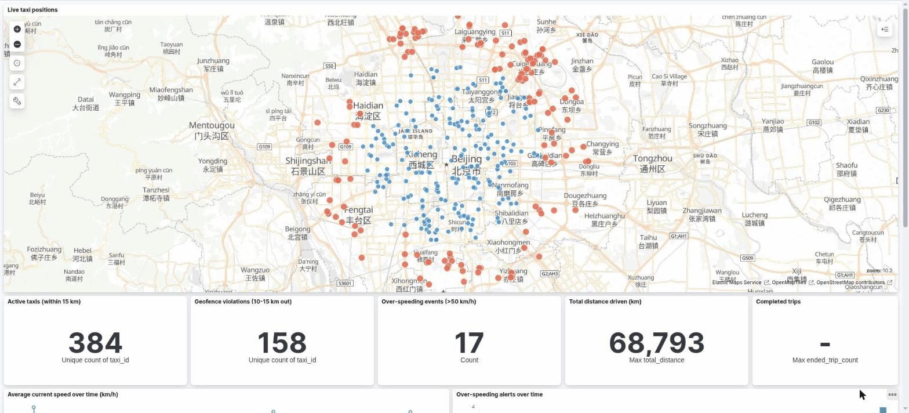

# 🚖 Real-Time Taxi Fleet Monitoring Engine

A streaming data platform that replays GPS traces of **10,000+ taxis** and turns them into live fleet metrics: current and average speed, active taxis, over-speeding alerts, geofence violations and completed trips, shown on a **Kibana** dashboard that refreshes every few seconds.

*Built as a team of 4 for the **Big Data** module at TU Hamburg.*

## 🏗️ Architecture

```
GPS trace replay ──► Kafka topic "taxi" ──► Apache Flink (PyFlink) ──► Kafka result topics ──► Logstash ──► Elasticsearch ──► Kibana
 (Python producer)                          │                                                                          dashboard
                                            └── Redis (per-taxi state)
```

| Service | Role |
|---|---|
| **Kafka producer** (`data_provider/`) | Reads the raw GPS log and replays it into Kafka in event-time order, with a configurable fast-forward factor |
| **Kafka + Zookeeper** | Message broker; topics `taxi`, `active_taxi`, `metrics`, `over_speeding`, `avg_speed`, `ended_taxi` |
| **Flink app** (`flink_app/`) | Event-time stream processing with watermarks; writes results back to Kafka |
| **Redis** | Keeps the latest state per taxi between events |
| **Logstash connector** (`kafka_elasticsearch_connector/`) | Routes each result topic into its own Elasticsearch index |
| **Elasticsearch + Kibana** | Storage, search and the live dashboard |

## ⚙️ Stream Processing Operators

| Operator | What it computes |
|---|---|
| `preprocess` | Cleans the stream and drops physically impossible jumps (> 300 km/h) |
| `calculate_distance` | Distance between consecutive GPS points (haversine formula) |
| `calculate_speed` | Current speed per taxi; flags **over-speeding** above 50 km/h |
| `calculate_avg_speed` | Running average speed per taxi |
| `active_taxi` | Tracks active taxis and flags those more than 15 km from the city centre (geofence) |
| `ended_taxi` | Counts completed trips |

## 🚀 Run It

**Prerequisites:** Docker with Docker Compose.

```bash
git clone https://github.com/sainap050620/Taxi-monitoring-system.git
cd Taxi-monitoring-system
docker compose up -d
```

The GPS dataset (`taxi_log_2008_by_id.zip`, Beijing taxi trajectories from February 2008) is **not included** in the repository. Place it in `volumes/kafka-producer_volume/` before starting.

Then open the Kibana dashboard:

```
http://localhost:5601/app/dashboards#/view/aea780f0-1ee2-11ef-a2ca-172534fb526f?embed=true&_g=(refreshInterval:(pause:!f,value:5000),time:(from:now-7d%2Fd,to:now))&hide-filter-bar=true
```

The Flink web UI is available at `http://localhost:8081`.

Stop everything with:

```bash
docker compose down
```

## 🎬 Demo

> **Why there is no hosted link:** the platform needs Kafka, Zookeeper, Flink, Redis, Logstash, Elasticsearch and Kibana running together, which does not fit on any free hosting tier. It runs locally with one command (see [Run It](#-run-it)).

**What you see once it is running** (Kibana dashboard, refreshing every 5 seconds):

| Panel | Shows |
|---|---|
| Active taxis | How many of the 10,000+ taxis are currently reporting, and which are outside the 15 km geofence |
| Speed | Current and running average speed per taxi |
| Over-speeding | Taxis above 50 km/h as they happen |
| Completed trips | Running count of ended trips |

The producer replays Beijing taxi traces from February 2008 faster than real time, so a few minutes of runtime covers hours of fleet activity. Watch the Flink job process the stream at `http://localhost:8081`.

<!-- To add a recording: run the stack, capture the Kibana dashboard as a GIF (for example with Peek or ScreenToGif), save it as docs/demo.gif and add this line here:

-->

## 🛠️ Tech Stack

Python · Apache Kafka · Apache Flink (PyFlink) · Redis · Logstash · Elasticsearch · Kibana · Docker Compose

## 📄 License

MIT License, see [LICENSE](LICENSE).
